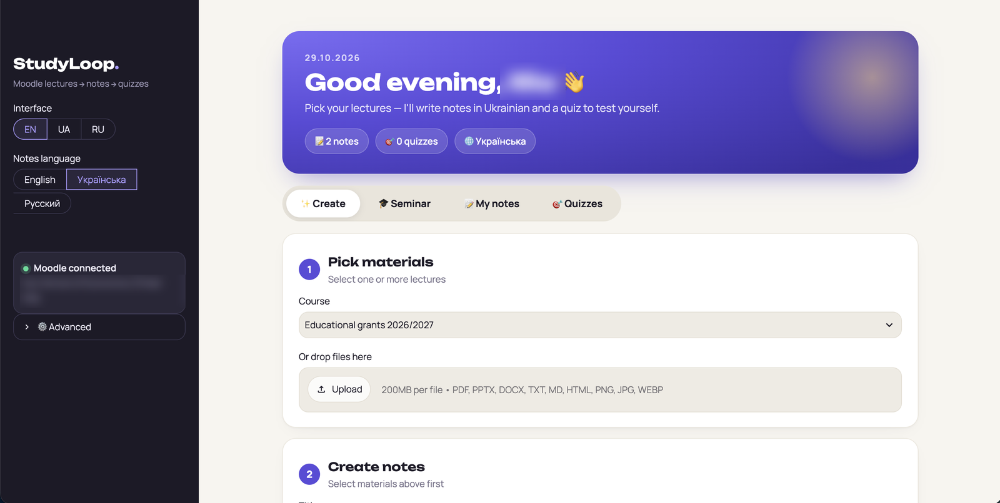
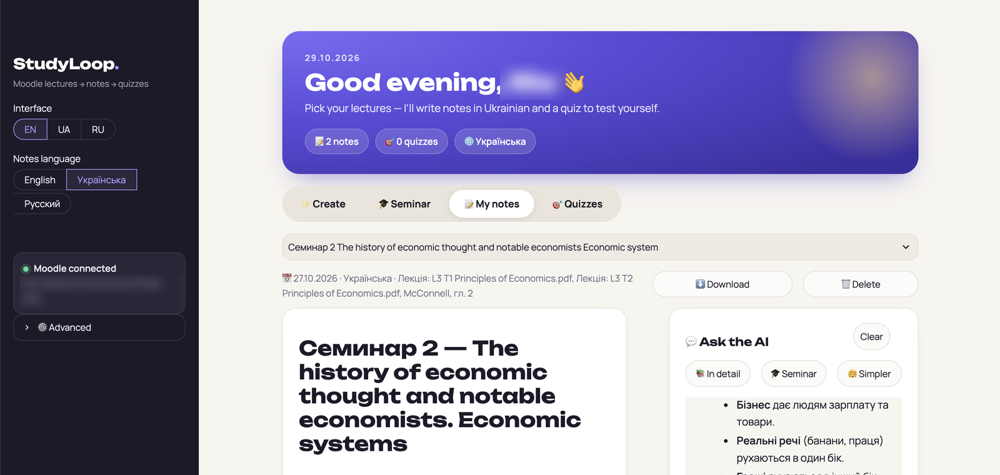

# StudyLoop

**Turn your Moodle lectures into study notes and quizzes — with a free AI that runs on your own computer.**

I'm a student. Every week Moodle fills up with slides, PDFs and textbook chapters, and I wanted
one place that reads them for me, writes clear notes in my language and then checks whether I actually understood.
So I built it.



## What it does

- **Pulls materials straight from Moodle.** Sign in once with Google, pick a course, tick the lectures you need.
  PDF, PowerPoint, Word, HTML and images all work — or just drag files in.
- **Writes detailed notes** in English, Ukrainian or Russian, whatever language the slides are in.
  Formulas stay as LaTeX, key terms keep the original word in brackets.
- **Makes quizzes** from your notes: multiple choice, with explanations for every wrong answer.
- **Lets you chat with the lecture.** Ask “explain this simpler” or “what could they ask at the seminar?”.
  Anything the AI adds that is not from the lecture is clearly marked.
- **Prepares you for seminars.** It reads the course syllabus, finds the topic, matching lectures and the exact
  textbook pages, and writes a prep sheet: key concepts, discussion questions with answers, typical mistakes,
  examples and a checklist.
- **Reads scanned pages and formulas** with a vision model when a PDF has no text layer.
- **Interface in English, Ukrainian and Russian.**



## Why local AI

Everything runs through [Ollama](https://ollama.com) on your machine:

- **free** — no API keys, no subscriptions;
- **private** — your materials and your Moodle token never leave your computer;
- **works offline** once the materials are downloaded.

The trade-off is speed: a long lecture takes a few minutes. Generation runs in the background, so you can keep
reading other notes meanwhile.

## Getting started

You need Python 3.11+, Google Chrome (for the Moodle sign-in window) and [Ollama](https://ollama.com).

```bash
git clone https://github.com/econnx/studyloop.git
cd studyloop
python3 -m venv .venv
.venv/bin/pip install -r requirements.txt

ollama pull gemma4:12b-it-q8_0   # what I use on a 24 GB Mac; image reading needs a vision model

./start.sh                       # opens http://localhost:8501
```

Then enter your Moodle address in the sidebar and click **Sign in with Google**. If your university uses another
sign-in method, open *Other ways to sign in* and paste a Moodle mobile web service token.

## How it works

| File | What it does |
|---|---|
| `app.py` | Streamlit interface |
| `moodle.py` | Moodle Web Services API — the same one the official mobile app uses |
| `google_login.py` | Google sign-in in a separate Chrome window, catches the mobile-app token |
| `extract.py` | Text from PDF, PPTX, DOCX, HTML and images |
| `ai.py` | Prompts for notes, quizzes, chat and seminar prep (Ollama) |
| `seminar.py` | Syllabus parsing, matching lectures and textbook pages to a seminar |
| `jobs.py` | Background generation so the page stays usable |
| `i18n.py` | Interface translations |

Your data (token, notes, cache) lives in the `data/` folder, which is never committed.

## Roadmap

- [ ] Export notes to PDF / Word
- [ ] Flashcards with spaced repetition
- [ ] One-click installer for classmates

---

Built by [@Econnx1](https://x.com/Econnx1) 🇺🇦
